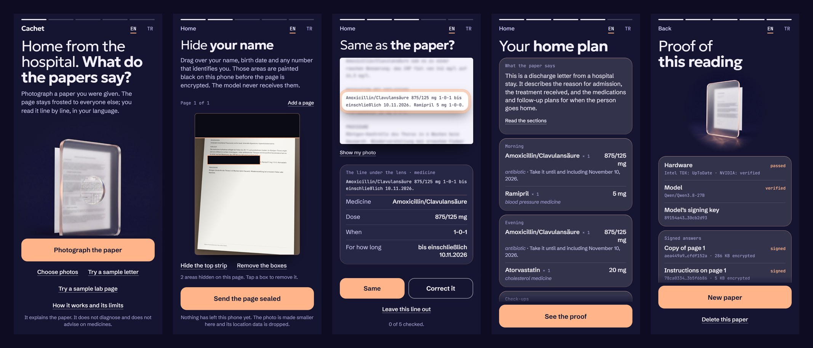

# Cachet

Take a photo of the papers you brought home from the hospital. Cachet turns them into a home plan in your language: the medicines, the follow-ups and what to watch for, each one shown next to the line of the paper it came from.

The page is encrypted on your phone to a key that exists only inside the model's enclave on [NEAR AI Cloud](https://cloud.near.ai). Your browser checks the hardware evidence before anything is sent, and checks the model's signature on every reply.

Cachet explains a document. It does not diagnose, and it does not give treatment advice.



- **Live demo:** https://cachet.l3ekirerdem.workers.dev (open it on a phone, or in a narrow browser window)
- **Built for:** NEAR HACKATHON 2026, tracks `privacy` and `open`. Solo project.
- **Contract (NEAR testnet):** [`receipts.bekir16-dev.testnet`](https://testnet.nearblocks.io/address/receipts.bekir16-dev.testnet)

## The problem

People leave the hospital with papers they only half understand, and the mistakes happen at home.

- In a review of studies on adults after discharge, the median share of patients with a medication error was 53%, and close to 20% were affected by an adverse drug event ([Alqenae et al., Drug Safety 2020](https://doi.org/10.1007/s40264-020-00918-3)).
- 40 to 80% of what a clinician says is forgotten immediately ([Kessels, J R Soc Med 2003](https://pmc.ncbi.nlm.nih.gov/articles/PMC539473/)).
- The paper is often read by a relative, and sometimes it is in a language the reader does not speak.

General chatbots already rewrite such documents, and that is where the risk is. When GPT-4 turned 50 discharge summaries into patient language, understandability rose from 13% to 81%, but only 54 of 100 reviews rated the result fully accurate, and most errors were omissions ([Zaretsky et al., JAMA Network Open 2024](https://jamanetwork.com/journals/jamanetworkopen/fullarticle/10.1001/jamanetworkopen.2024.0357)). The authors concluded a physician has to review the output.

Cachet is built around that finding. The model is never asked to rewrite the paper.

## How it works

1. **Photo.** You photograph each page. The image is scaled down and re-encoded on the phone, which drops location and camera data.
2. **Hide your name.** You drag a box over the lines that identify you. The boxes are burned into the pixels before encryption, so the model never receives that area.
3. **Sealed sending.** The browser fetches the hardware evidence for the model (Intel TDX, NVIDIA GPU), verifies it, and encrypts the page to the key that the evidence vouches for. Our server forwards ciphertext and adds the API key. It refuses any request that is not encrypted this way.
4. **Copy.** A vision model inside the enclave copies what is printed: text, lab rows, values, ranges. It is told to copy, not to explain.
5. **Same as the paper?** You compare every line with your paper and confirm or correct it. A line you do not confirm does not enter the plan.
6. **Plan.** From the confirmed text, the model points at the instructions: medicines, follow-ups, cautions. Each entry must carry the exact line it came from. Code then checks every entry against the page (see below) and retells it in your language.
7. **Proof.** You see what was verified. The model's signature over the encrypted exchange is recorded on NEAR, where the contract verifies it again.

The result stays on your phone. There is no account, and our server stores nothing.

## What code decides, not the model

| Question | Decided by | Where |
|---|---|---|
| Is a lab value inside its range? | Arithmetic on the range printed on the same page. No medical reference data. | [`core/ranges.mjs`](core/ranges.mjs) |
| Is this plan entry really on the paper? | The entry's source line must be found in the page text, and the medicine, dose, schedule and duration must be found inside that line. Otherwise the entry is rejected. | [`core/plan.mjs`](core/plan.mjs) `checkPlan` |
| What does "1-0-1" mean? | Parsed in code as morning, noon, evening (and night). | [`core/plan.mjs`](core/plan.mjs) `readSlots` |
| Did the plain-language version add a number? | Every number in a retold entry must appear in that entry's own source line. | [`core/plan.mjs`](core/plan.mjs) `checkPlain` |
| Did the explanation of a lab page add a number? | Every number must be printed on the page. | [`core/explain.mjs`](core/explain.mjs) `checkExplanation` |
| What does the paper leave out? | A medicine without a printed dose, schedule or duration becomes a question for the doctor. | [`core/plan.mjs`](core/plan.mjs) `openPoints` |
| Did the reply come from the attested model? | ed25519 signature over `model:sha256(request):sha256(response)`, checked in the browser and in the contract. | [`core/receipt.mjs`](core/receipt.mjs), [`contract/src/lib.rs`](contract/src/lib.rs) |

One thing does come from the model's general knowledge: the kind of a medicine ("antibiotic", "blood pressure medicine"). The app shows it in a different style from text that comes from the paper, and it can be empty.

## Try it

No account, no key, no wallet. The samples are fictional.

**In the browser** (https://cachet.l3ekirerdem.workers.dev, on a phone or in a narrow window):

| Do | See |
|---|---|
| Open the page | "Home from the hospital. What do the papers say?" and one main button |
| Tap **Try a sample letter** | "Hide your name" with the photographed German discharge letter |
| Tap **Hide the top strip**, then **Send the page sealed** | A black box over the top of the page, then three checks arriving: "Hardware checked, passed" with the seconds it took on your device, "Page encrypted" with the size of the ciphertext that left, "Model reading" |
| Wait about 20 seconds | "Same as the paper?" with the first line under the lens: `Amoxicillin/Clavulansäure 875/125 mg 1-0-1 bis einschließlich 10.11.2026.` split into medicine, dose, when, for how long |
| Tap **Same** for each of the 5 lines (or **Correct it**, or **Leave this line out**), then **Make my plan** | "Your home plan": Morning with Amoxicillin/Clavulansäure 875/125 mg and Ramipril 5 mg, Evening with Amoxicillin/Clavulansäure and Atorvastatin 20 mg, the X-ray check-up in 6 weeks, when to come back, and "Ramipril: the paper does not say for how long" |
| Tap any line of the plan | The line of the paper it came from |
| Tap **See the proof** | Intel TDX `UpToDate`, NVIDIA `verified`, the model's signing key, four signed answers, and four chain records, each a link to the transaction on NEAR testnet |
| Choose another language under **Write it in another language** | The same plan rewritten and checked again; Arabic is laid out right to left |
| Go home and tap **Try a sample lab page** | 12 rows of a Turkish lab report; after you confirm them, each row is placed in, above or below the range printed on the page |

**On the command line** (Node 24 or later):

| Do | See |
|---|---|
| `cd core && node --test` | 20 tests pass: number and range parsing, the plan checks, the explanation check |
| `cd tools && npm install && npm run verify-tee` | Your computer verifies the gateway and both models against Intel and NVIDIA, ending with `VERIFIED`. No key needed |
| `curl -X POST https://cachet.l3ekirerdem.workers.dev/v1/chat/completions -H "content-type: application/json" -d '{"model":"Qwen/Qwen3.8-27B","max_tokens":5,"messages":[{"role":"user","content":"hi"}]}'` | `400`: "This relay only forwards requests that are encrypted to the model on the device." |
| `cd contract && cargo test` | 6 tests pass on a real receipt: accepted once; a repeat, a changed hash, another model name, an unknown key and a non-owner are refused |

## How NEAR is used

**NEAR AI Cloud is in the critical path of every reading.**

- Models: `Qwen/Qwen3.8-27B` and `z-ai/glm-5.3-flash`, both served from GPU TEEs.
- The browser verifies the attestation itself with the official [`@nearai/inference-sdk`](https://www.npmjs.com/package/@nearai/inference-sdk): Intel TDX quote, NVIDIA GPU evidence, and the binding of the model's public key to that evidence.
- Requests are end-to-end encrypted to that key (`e2ee: true`), image included. NEAR AI's encryption guide gives text examples; this repository measures it with photographed pages.
- Every reply's signature is verified before anything is shown.

**A NEAR contract verifies the model's signature on chain.**

[`contract/`](contract/) is a small Rust contract deployed at `receipts.bekir16-dev.testnet`. `record` takes the five fields of a receipt, rebuilds the signed text, and calls `env::ed25519_verify` with the enclave's public key. A receipt is counted once, per model. It contains hashes of ciphertext and nothing about the person or the document.

- Anyone can call `record`; nobody, including us, can add a reading the enclave did not sign.
- Measured cost of one record: 2.39 Tgas, 0.000239 NEAR ([transaction](https://testnet.nearblocks.io/txns/AUz2u8TRkWuRTH49gqYfU5qff5GstAsy1w82xrTvbYkn)).
- `stats` is a public, unforgeable count of real uses of NEAR's private models. The contract is not specific to this app: any app on NEAR AI Cloud can record its signed replies in it.
- Limit: the contract trusts a list of enclave keys that its owner maintains. The attestation that ties a key to hardware is verified off chain, in the browser.

The product would work without a chain. The chain's job here is narrow and honest: a usage record that cannot be inflated.

## Measurements

All runs went through the same path as the app: attestation verified, request encrypted end to end, reply signature verified. Scripts are in [`tools/`](tools/), samples in [`samples/`](samples/).

**Fictional samples** (7 documents with known answers, each as a clean scan and as a simulated phone photo: lab reports in Turkish, German, English, Spanish and Japanese, discharge letters in German and Turkish). Run of 14 Nov 2026:

| Model | Pages read | Lab values copied correctly | In-range decision correct | Letter facts found | Seconds per page | Cost per page |
|---|---|---|---|---|---|---|
| Qwen/Qwen3.8-27B | 14 of 14 | 106 of 106 | 106 of 106 | 50 of 50 | 7.9 to 20.5 (median 13.8) | $0.0010 |
| z-ai/glm-5.3-flash | 14 of 14 | 106 of 106 | 106 of 106 | 50 of 50 | 7.2 to 43.3 (median 24.6) | $0.0005 |

**Take-home plan** (Qwen/Qwen3.8-27B):

| Pages | Result |
|---|---|
| 4 fictional letter pages with known medicines | 10 of 10 medicine entries exact (name, strength, schedule, duration), 0 extra |
| 9 pages of published sample letters (German, English) | All read. Two pages checked by eye: medicines exact; one diet line was left out of the cautions |
| Retelling in Turkish, all 13 pages | 0 entries rejected by the code check |

**Published sample documents** (29 pages from 21 documents found online: labs, letters, imaging, prescriptions; not included in this repository): 28 pages read on the first pass, the last one on a retry. On a real phone photo of a Turkish blood count, the in-range decision in code agreed with the mark the lab printed on 18 of 18 rows. A handwritten prescription and a cropped typewritten letter were reported by the model as partly unreadable, which is the intended behaviour.

What these numbers are not: a clinical validation. The samples with known answers are fictional, the published samples were not checked value by value, and nobody has used this at home yet.

## What the privacy protects, and what it does not

- **Protects:** the operator of the service and the owner of the server cannot read your page. This rests on hardware evidence your browser checks, not on a policy.
- **Does not protect:** a vulnerability in the software running inside the enclave. On 8 Nov 2026 NEAR AI [reported](https://near.ai/blog/security-incident-report-sglang-vulnerability) exactly that: code execution inside one inference server, where requests in processing, including confidential ones, could have been observed. In their words: "Confidential computing protects data from the operator and the host. It does not protect against a vulnerability in the software running inside the environment."
- **What Cachet does about it:** it sends as little as possible and keeps nothing. Your name is hidden on the phone before encryption, there are no accounts, and neither the page nor the plan is stored on a server. What was taken in that incident was stored data (account details, chat histories, API keys in logs); Cachet has none of the first two, and its relay does not log request bodies.
- **Also outside the protection:** your own phone, and physical attacks on the host hardware.

## Repository

| Path | What it is |
|---|---|
| [`web/`](web/) | The phone web app (installable PWA). |
| [`core/`](core/) | Prompts, schemas and every check listed above, with tests. No UI, no network. |
| [`relay/`](relay/) | Cloudflare Worker: serves the app, forwards encrypted requests, records receipts. |
| [`contract/`](contract/) | NEAR contract that verifies and counts receipts, with tests on a real receipt. |
| [`samples/`](samples/) | Fictional documents and their known answers. |
| [`tools/`](tools/) | Measurement and deployment scripts. |
| [`docs/`](docs/) | The screenshot above. |
| [`design-dna.md`](design-dna.md) | The rules of the interface. |

## Run it yourself

You need Node 24 or later, a NEAR AI Cloud API key, and for the chain part Rust with the `wasm32-unknown-unknown` target and a NEAR testnet account whose key is in `~/.near-credentials/testnet/`.

```sh
cp .env.example .env            # put your NEAR AI Cloud key in it

# the checks, no key needed
cd core && node --test

# measurements (these call the model)
cd ../tools && npm install
npm run eval                    # fictional samples, known answers
npm run plan                    # take-home plan on letters

# the app, served by the relay on one address
cd ../web && npm install && npm run build
cd ../relay
cp ../.env .dev.vars            # the relay reads NEARAI_API_KEY from here
wrangler dev --port 8799        # open http://127.0.0.1:8799
```

Chain records are optional locally. To turn them on, deploy the contract and give the relay a key that can only call `record`:

```sh
cd contract && cargo build --target wasm32-unknown-unknown --release
cd ../tools
OWNER=you.testnet SIGNERS=<model key>,<model key> npm run deploy-contract
OWNER=you.testnet npm run add-receipt-key   # then add NEAR_RECEIPT_KEY to relay/.dev.vars
```

The model keys are printed by `npm run verify-tee`. Set `NEAR_ACCOUNT_ID` and `RECEIPT_CONTRACT` in `relay/wrangler.jsonc` to your own.

## What is new and what is baseline

Everything in this repository was written during the hackathon window (first code on 12 Nov 2026). Dependencies: [`@nearai/inference-sdk`](https://www.npmjs.com/package/@nearai/inference-sdk) (attestation, encryption, signatures), [`near-sdk`](https://crates.io/crates/near-sdk) (contract), [`near-api-js`](https://www.npmjs.com/package/near-api-js) (deployment and receipts), [Vite](https://vite.dev) and three bundled variable fonts (Geologica, Schibsted Grotesk, JetBrains Mono).

AI assistance: the code was written with Claude Code, directed and reviewed by the author. The 3D images in the interface were generated with Gemini.

## Limits

- Printed documents only. Handwriting is reported as unreadable.
- Omissions are possible: the plan can miss a line that is on the paper. The copied text of the paper is always one tap away for that reason.
- The kind of a medicine is general knowledge from the model, not from the paper.
- Testnet only. The receipts contract trusts an owner-maintained list of enclave keys.
- Not yet used on a physical phone by anyone but the author's browser tests: camera capture, finger-drawn boxes, installing to the home screen and the share sheet were exercised in desktop Chrome at phone size only.
- One model reads each page. A second, independent reading that flags disagreements is not built.
- The code-written words of the plan in German, Spanish, French, Arabic, Russian and Japanese are unreviewed translations.
- The public demo runs on a fixed credit: 800 model calls a day, then it answers "today's free readings are used up".

## License

MIT. See [`LICENSE`](LICENSE).
